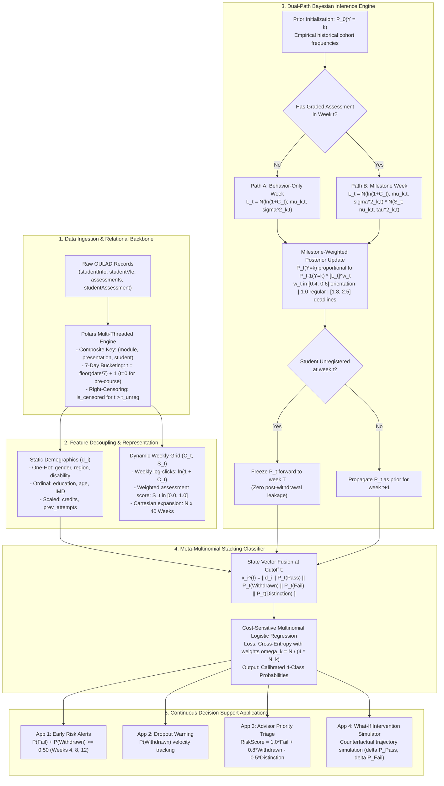

# AURA: Adaptive User Risk Analytics
### Dual-Path Bayesian Early Warning Architecture

[](https://www.python.org/downloads/)
[](LICENSE)
[](https://pola.rs/)

An end-to-end machine learning system built on the **Open University Learning Analytics Dataset (OULAD)** for continuous risk monitoring, early dropout forecasting, advisor intervention triage, and counterfactual simulation in virtual learning environments.

---

## 1. Executive Summary & Problem Formulation

Predicting student academic attrition and at-risk outcomes in Virtual Learning Environments (VLEs) poses three core statistical challenges:

1. **Asynchronous Milestone Sparsity**: Graded assessments occur intermittently (typically 3–5 times per term), while student interaction logs stream continuously on a daily basis.
2. **Temporal Asymmetry**: Early-semester engagement contains lower predictive signal than midterm and revision windows, requiring time-weighted evidence accumulation.
3. **Severe Class Imbalance**: Distinct outcome distributions across academic categories (`Pass` ~38%, `Withdrawn` ~31%, `Fail` ~21%, `Distinction` ~10%).

**AURA** resolves these challenges by decoupling high-frequency continuous engagement modeling from discrete milestone assessments and static demographic traits using a two-stage hybrid architecture:
- **Dual-Path Naive Bayes Engine**: Alternates dynamically between interaction-only weeks (Path A) and milestone submission weeks (Path B), propagating time-weighted Bayesian posteriors forward with temporal withdrawal freezing.
- **Meta-Multinomial Logistic Regression Layer**: Fuses running dynamic behavioral vectors with static demographic indicators to output calibrated 4-class probabilities under cost-sensitive class balancing.

---

## 2. System Architecture



---

## 3. Mathematical & Algorithmic Formulation

### 3.1 Initial Priors (Cold-Start Resolution)
At week $t = 0$, prior belief $P_0(Y = k)$ for each class $k \in \{\text{Pass}, \text{Withdrawn}, \text{Fail}, \text{Distinction}\}$ is initialized to historical training cohort baselines:
$$P_0(Y = k) = \frac{N_k}{\sum_{j=1}^{4} N_j}$$

### 3.2 Dual-Path Bayesian Likelihood Engine
For student $i$ in week $t$:
- **Path A (Behavior-Only Weeks — No Graded Assessment)**:
  $$P(E_t \mid Y = k) = \frac{1}{\sqrt{2\pi\sigma_{k,t}^2}} \exp\left( -\frac{(\tilde{C}_t - \mu_{k,t})^2}{2\sigma_{k,t}^2} \right)$$
  where $\tilde{C}_t = \ln(1 + C_t)$.

- **Path B (Milestone Weeks — Assessment Submitted)**:
  Under class-conditional independence:
  $$P(E_t \mid Y = k) = P(\tilde{C}_t \mid Y = k) \cdot \frac{1}{\sqrt{2\pi\tau_{k,t}^2}} \exp\left( -\frac{(S_t - \nu_{k,t})^2}{2\tau_{k,t}^2} \right)$$
  where $S_t \in [0.0, 1.0]$ is the credit-weighted normalized score.

### 3.3 Exponential Milestone Weighting
$$P_t(Y = k) = \frac{P_{t-1}(Y = k) \cdot [P(E_t \mid Y = k)]^{w_t}}{\sum_{j=1}^{4} \left( P_{t-1}(Y = j) \cdot [P(E_t \mid Y = j)]^{w_t} \right)}$$
- $w_t \in [0.4, 0.6]$ for early orientation weeks ($t \in [0, 3]$) to dampen noise.
- $w_t = 1.0$ for standard instructional weeks.
- $w_t \in [1.8, 2.5]$ for assessment submission deadlines.

### 3.4 Temporal Freeze for Unregistered Students
When a student withdraws at week $t_{\text{withdraw}}$:
$$P_t(Y = k) = P_{t_{\text{withdraw}}}(Y = k) \quad \forall t > t_{\text{withdraw}}$$
Post-withdrawal logs are masked to zero with `is_censored = True`, preventing artificial zero-activity leakage.

### 3.5 Meta-Classifier Stacking Layer
$$\mathbf{x}_i^{(t)} = \left[ \mathbf{d}_i \,\Vert{}\, P_t(Y = \text{Pass}) \,\Vert{}\, P_t(Y = \text{Withdrawn}) \,\Vert{}\, P_t(Y = \text{Fail}) \,\Vert{}\, P_t(Y = \text{Distinction}) \right]$$
Softmax multi-class output:
$$P(Y = k \mid \mathbf{x}_i^{(t)}) = \frac{\exp\left( \mathbf{\beta}_k^T \mathbf{x}_i^{(t)} + \alpha_k \right)}{\sum_{j=1}^{4} \exp\left( \mathbf{\beta}_j^T \mathbf{x}_i^{(t)} + \alpha_j \right)}$$

---

## 4. Repository Structure

```text
AURA/
├── configs/                  # Schema, binning, and hyperparameter configurations
├── data/
│   ├── raw/                  # Raw OULAD CSV files (fetched via kagglehub)
│   ├── interim/              # Pre-bucketed intermediate tables
│   └── processed/            # Serialized Parquet feature matrices and split arrays
├── doc/
│   ├── architecture.md       # Comprehensive system architecture & data contracts
│   ├── data_dictionary.md    # Relational schemas, feature catalog & target encodings
│   └── phase1_plan.md        # Phase 1 ingestion, normalization & validation blueprint
├── notebooks/
│   ├── 01_eda_and_cleaning.ipynb   # Phase 1 EDA & validation pipeline
│   ├── 02_model_training.ipynb     # Phase 2 & 3 Dual-Path Bayes training & tuning
│   └── 03_dashboard_demo.ipynb     # Phase 5 & 6 Decision support & what-if simulator
├── src/
│   ├── __init__.py
│   ├── data_loader.py        # Ingestion, weekly bucketing, grid realization & split logic
│   ├── dual_path_nb.py       # Custom Dual-Path Bayesian inference engine
│   ├── meta_classifier.py    # Meta-Multinomial Logistic Regression stacking layer
│   └── evaluation.py         # Multi-class evaluation metrics & triage prioritization
├── requirements.txt          # Python dependencies
└── README.md
```

---

## 5. Decision Support Applications

1. **Early Identification of At-Risk Students**: Evaluated at Weeks 4, 8, and 12:
   $$\text{Flag At-Risk} \iff [P_t(Y = \text{Fail}) + P_t(Y = \text{Withdrawn})] \ge 0.50$$
2. **Student Dropout Prediction**: Continuous tracking of $P_t(Y = \text{Withdrawn})$, alerting advisors weeks before formal unregistration.
3. **Academic Intervention Prioritization**: Institutional triage queue ranked by severity:
   $$\text{RiskScore}_i = 1.0 \cdot P(Y = \text{Fail}) + 0.8 \cdot P(Y = \text{Withdrawn}) - 0.5 \cdot P(Y = \text{Distinction})$$
4. **Course Completion Forecasting**: Binary success forecast ($P(\text{Pass}) + P(\text{Distinction}) \ge 0.50$).
5. **Faculty Explainable Trajectories**: Time-series visualization of posterior movements annotated with missed milestones.
6. **Counterfactual ("What-If") Simulator**: Interactive simulation for advisors projecting recovery paths under hypothetical engagement boosts:
   $$\Delta P(\text{Pass}) = P_{\text{sim}}(Y = \text{Pass}) - P_{\text{curr}}(Y = \text{Pass})$$

---

## 6. Getting Started

### Prerequisites
- Python 3.10+
- Virtual environment (`venv` or `conda`)

### Installation
```bash
python3 -m venv .venv
source .venv/bin/activate
pip install -r requirements.txt
```

### Automated Dataset Download & Pipeline Run
The ingestion pipeline fetches OULAD automatically on the fly via `kagglehub`:
```bash
python3 src/data_loader.py
```

---

## 7. Commit Convention

This repository follows [Conventional Commits](https://www.conventionalcommits.org/):
- `feat: ...` — New features or model components
- `fix: ...` — Bug fixes
- `docs: ...` — Documentation updates
- `refactor: ...` — Structural code improvements without functional changes
- `test: ...` — Adding or updating test suites
- `chore: ...` — Repository maintenance, dependencies, or configuration changes
